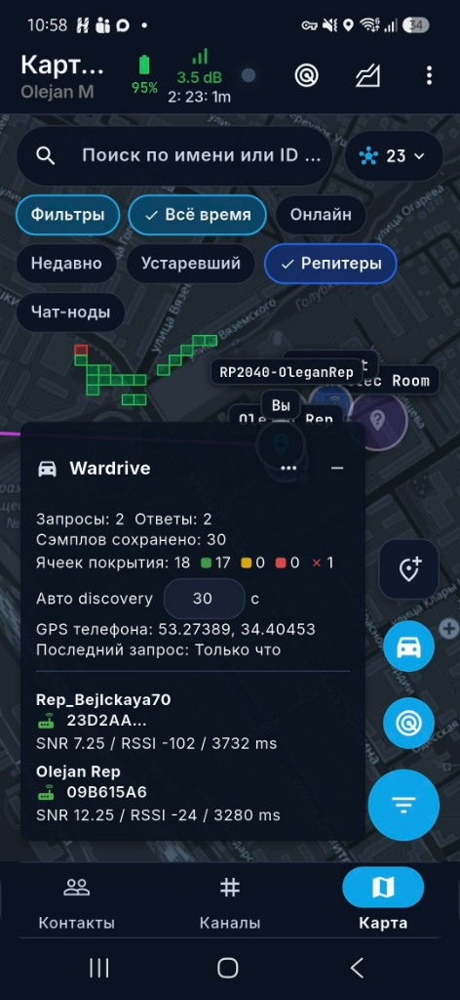
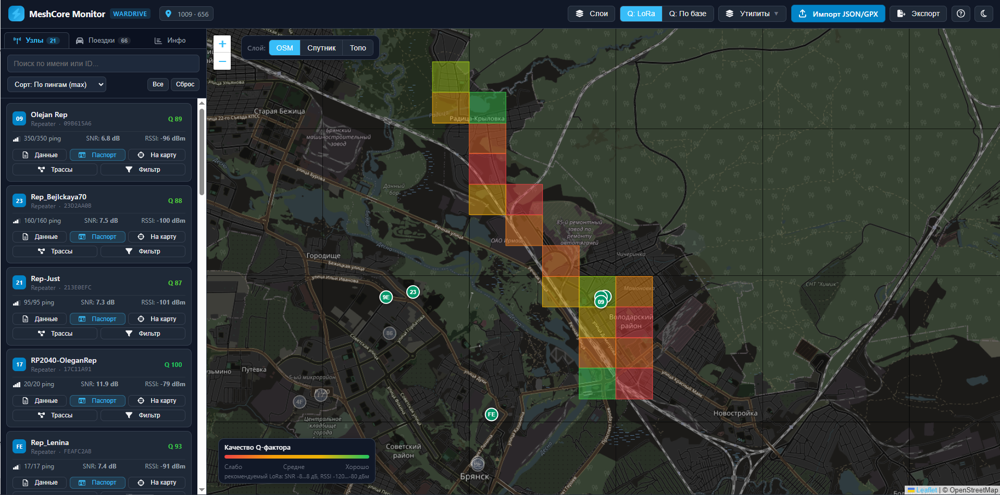
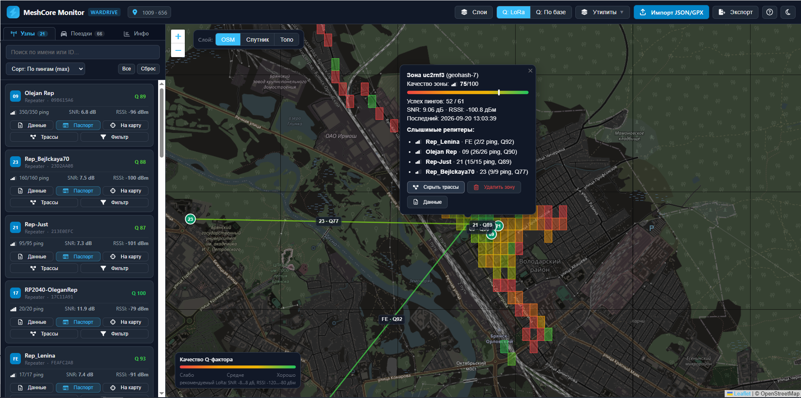
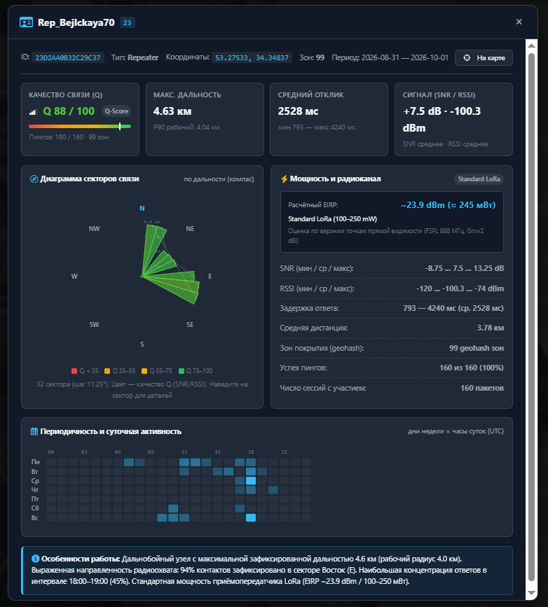
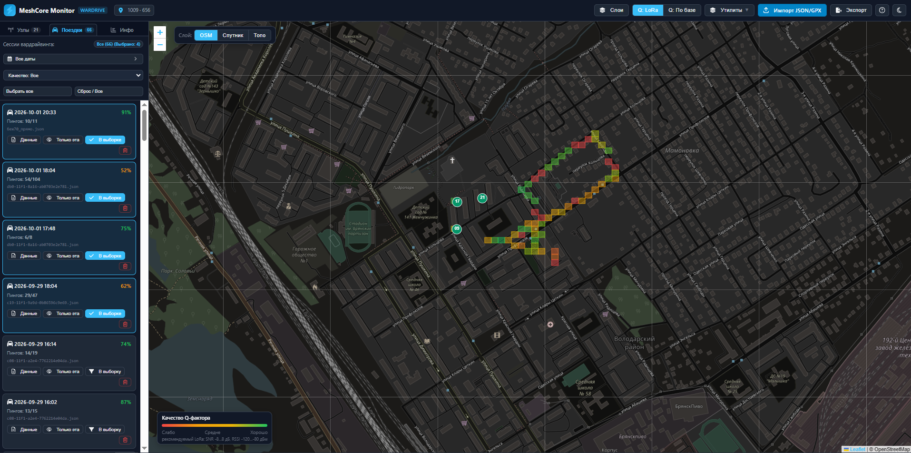
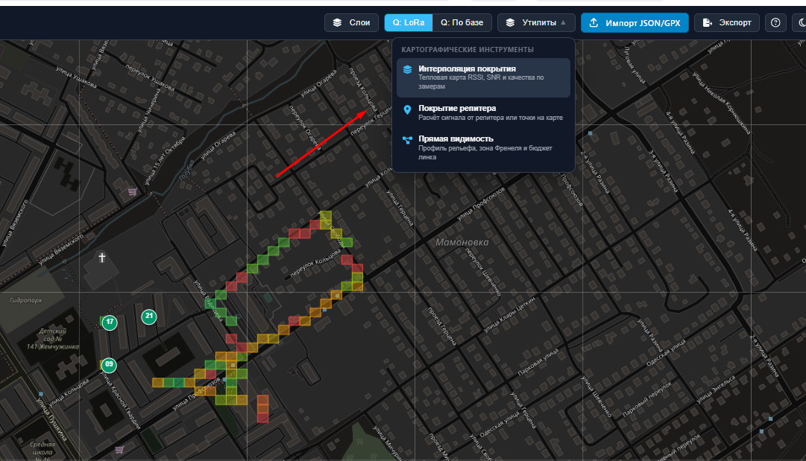
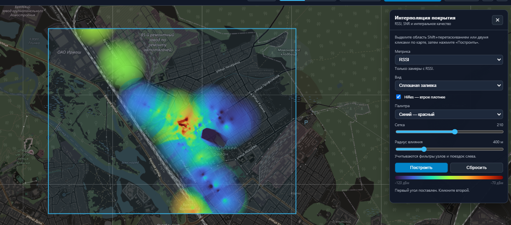
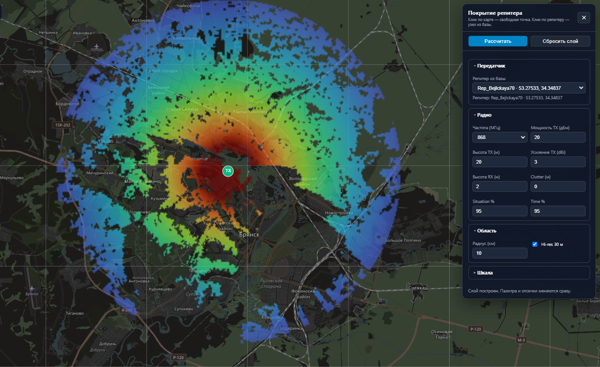
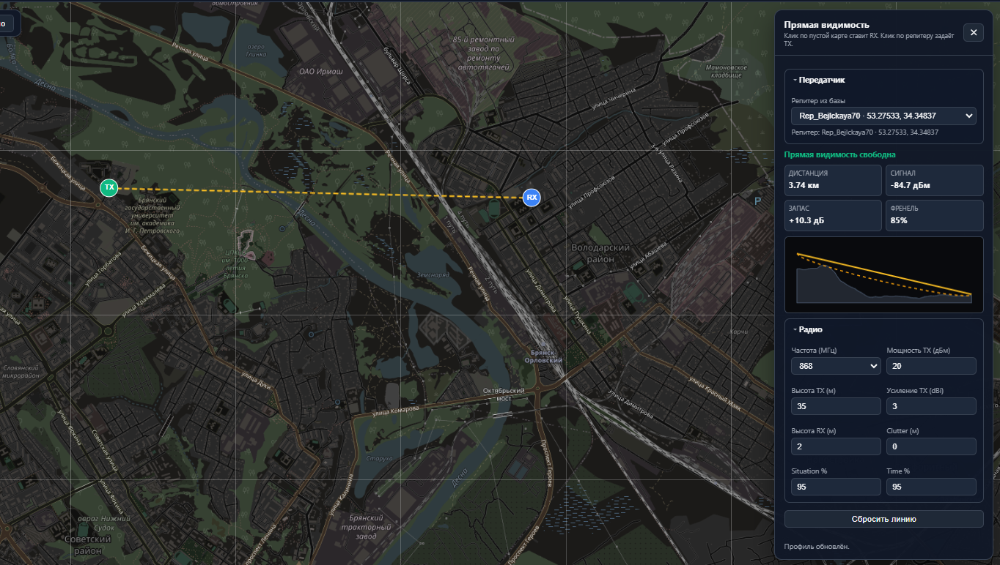

# MeshCore Wardrive Monitor

Программа показывает, как на самом деле слышно сеть MeshCore, и помогает решить, куда ставить следующий репитер.

Слева список узлов и поездок, справа карта. Замеры с вардрайва собираются в цветные ячейки: красный — связь слабая, зелёный — устойчивая. Цвет ячейки — это Q-фактор.

Импорт принимает JSON вардрайва и GPX. Экспорт отдаёт ту же базу обратно в JSON, чтобы перенести или отфильтровать выборку.

## Содержание

- [Откуда берутся замеры](#откуда-берутся-замеры)
- [Q-фактор](#q-фактор)
- [Карта и список узлов](#карта-и-список-узлов)
- [Зона и трассы](#зона-и-трассы)
- [Паспорт репитера](#паспорт-репитера)
- [Поездки](#поездки)
- [Инструменты](#инструменты)
  - [Интерполяция покрытия](#интерполяция-покрытия)
  - [Покрытие репитера](#покрытие-репитера)
  - [Прямая видимость](#прямая-видимость)
- [Как этим пользоваться](#как-этим-пользоваться)

## Откуда берутся замеры

Источник данных — телефонное приложение [MeshCore Open Advanced](https://github.com/HDDen/meshcore-open) (MCOa). В нём есть режим **Wardrive**: телефон едет по городу, шлёт запросы в сеть и записывает, кто ответил, с каким SNR и RSSI и из какой точки GPS.

На панели Wardrive видно, сколько запросов ушло и сколько ответов пришло, сколько сэмплов уже сохранено и сколько ячеек покрытия набралось. Цвет ячейки на карте телефона — тот же смысл, что потом на карте монитора: где связь есть, а где её почти нет. Интервал **Авто discovery** задаёт, как часто телефон сам опрашивает сеть. Внизу панели — узлы, которые ответили только что: имя, короткий идентификатор, SNR, RSSI и время отклика.

Файл этой поездки импортируется в монитор. Дальше Q-фактор, трассы и паспорт репитера считаются уже по накопленной базе, а не по одному проезду на экране телефона.

<p align="center">
  
</p>

## Q-фактор

Q-фактор — одна оценка качества связи от 0 до 100. Ею красится ячейка на карте, карточка репитера и линия трассы. 0 — из этой точки ответов нет. 100 — пинги доходят каждый раз, а SNR и RSSI стоят на верхней границе выбранной шкалы.

Считается он по всем пингам ячейки или узла, не по одному пакету:

```text
Q = 100 × Success × (0.45 + 0.55 × Signal)
```

**Success** — доля успешных ответов: сколько пингов дошло, делённое на сколько было отправлено. Промах обнуляет и свою долю надёжности, и вклад сигнала. При 50% ответов Q не поднимается выше 50, даже если слышно идеально. При 100% ответов, но сигнале на нижней границе шкалы, Q равен 45: связь устойчивая, но слабая.

**Signal** — уровень сигнала от 0 до 1:

```text
Signal = 0.6 × SNR + 0.4 × RSSI
```

SNR весит больше, потому что для LoRa он лучше говорит о запасе декодирования, чем сырая мощность. В среднее попадают только те пинги, где значение записано. Если SNR или RSSI нет, вместо него берётся сама доля успеха.

Перед взвешиванием SNR и RSSI приводятся к отрезку 0…1. Всё ниже нижней границы шкалы становится 0, всё выше верхней — 1. Какая шкала, выбирается переключателем **Q**:

- **Q: LoRa** — фиксированный диапазон, с которым обычно сравнивают канал: SNR от −8 до +8 дБ, RSSI от −120 до −80 дБм. Один и тот же замер получает один и тот же Q на любой базе.
- **Q: По базе** — границы берутся из самой выборки, по перцентилям 5% и 95% записанных SNR и RSSI. Крайние 5% с каждой стороны не растягивают шкалу. Так видны различия внутри ваших поездок: «хорошо» означает «лучше большинства ваших замеров», а не «хорошо по учебнику LoRa». Если по метрике разброса нет, для неё остаётся шкала LoRa.

Цвет идёт от красного при 0 через жёлтый в середине к зелёному при 100. Подпись на легенде — «слабо», «средне», «хорошо» — это те же баллы, без отдельной формулы.



## Карта и список узлов

Каждая карточка слева — репитер, который отвечал в поездках: имя, короткий идентификатор, число пингов, средний SNR и RSSI, Q-фактор.

- **Данные** открывает таблицу замеров.
- **Паспорт** открывает карточку узла.
- **На карту** переносит вид к этому репитеру.
- **Трассы** рисует линии от зон, где узел был слышен.
- **Фильтр** оставляет на карте только выбранные узлы.

Поиск и сортировка работают по имени, числу пингов, качеству и времени последнего ответа. Слои карты включают и выключают зоны, маркеры репитеров и трассы. Подложка — схема, спутник или топографическая карта.

## Зона и трассы

Клик по цветной ячейке показывает, что в ней произошло: сколько пингов дошло, SNR, RSSI, когда был последний ответ и какие репитеры слышны из этой точки.

Кнопка в карточке зоны включает и выключает трассы к этим репитерам. На линии подписано, сколько пингов ушло в этот узел и с каким качеством. Так видно не «среднее по городу», а конкретный путь: из этой улицы лучше всего отвечает вот этот репитер.



## Паспорт репитера

Паспорт собирает всё, что известно об одном узле.

Сверху — идентификатор, тип, координаты, число зон и период наблюдений. Дальше четыре цифры, по которым узел сравнивают с другими: качество Q, максимальная дальность, средний отклик в миллисекундах, средний SNR и RSSI.

Диаграмма секторов показывает, с какой стороны узел слышат. Цвет сектора — то же качество, длина — дальность. Рядом радиоканал: оценка мощности, разброс SNR и RSSI, задержка, средняя дистанция, число зон и успешность пингов.

Внизу сетка по дням недели и часам. По ней видно, когда узел реально в эфире, а не только где его когда-то поймали. Короткий вывод внизу карточки формулирует это словами: дальность, главный сектор и часы наибольшей активности.



## Поездки

Вкладка **Поездки** режет базу по выездам. У каждой сессии дата, файл, из которого она пришла, число пакетов и свой Q.

Можно оставить одну поездку или несколько. Карта сразу перерисовывается только по этим замерам: удобно сравнить вчерашний маршрут с сегодняшним или выкинуть проезд, который портит картину. Дата «от» и «до» сужает список ещё и по времени.



## Инструменты

Меню **Утилиты** — это уже не просмотр архива, а расчёт поверх карты. Три инструмента живут на той же карте, что и замеры, и не затирают ячейки.



Замеры отвечают на вопрос «где связь уже ловили». Инструменты отвечают на два других: «как выглядит поле между точками» и «что будет, если поставить репитер сюда».

### Интерполяция покрытия

Инструмент берёт реальные замеры внутри прямоугольника и рисует гладкое поле. Область задаётся Shift и протягиванием мыши или двумя кликами, затем **Построить**.

Метрика — RSSI, SNR или качество. Вид — сплошная заливка или контуры. Радиус влияния ограничивает, насколько далеко один замер красит соседние клетки: слой не заливает весь прямоугольник, а собирается островками вокруг данных. HiRes делает сетку плотнее. Палитра и легенда подписаны в децибелах или баллах качества.

Учитываются фильтры узлов и поездок слева. Если в списке выбрана одна поездка, тепловая карта строится только по ней.



### Покрытие репитера

Это прогноз, а не архив замеров. Модель считает уровень сигнала вокруг передатчика по рельефу: свободное пространство, тень холмов и статистический запас.

Передатчик берётся из списка репитеров базы или ставится кликом в любую точку. Клик по маркеру репитера на карте делает то же самое. В группе **Радио** задаются частота, мощность, высоты антенн и запас надёжности. **Situation %** и **Time %** по 95 — осторожный прогноз: уровень на карте должен держаться примерно в 95% мест и 95% времени. Чем проценты выше, тем покрытие скромнее.

**Рассчитать** всегда на виду. Пока качаются карты высот, виден счётчик тайлов, затем идёт расчёт лучей. Палитра, прозрачность и отсечки меняются сразу, без нового расчёта: сигнал слабее нижней отсечки просто не закрашивается. Слой можно спрятать в меню **Слои**, не удаляя его.

На картинке один и тот же город, что и на карте замеров. Красное ядро у антенны, дальше зелёный и синий, а по краям покрытие рвётся там, где рельеф закрывает луч. Это удобно ставить рядом с цветными ячейками вардрайва и смотреть, где модель и замеры сходятся.



### Прямая видимость

Инструмент проверяет одну линию: от передатчика до точки, куда вы кликнули. На карте это отрезок TX–RX, в панели — цифры и профиль земли.

Профиль рисует рельеф, прямую между антеннами и нижнюю границу первой зоны Френеля. Если земля пересекает эту границу, связь уже не «в чистом поле», даже если мачты ещё видят друг друга. В примере линия 3,74 км над долиной: видимость свободна, запас +10,5 дБ, просвет зоны Френеля 85%.

Параметры радио общие по смыслу с покрытием: та же частота, мощность и высоты. Сдвиг маркера или смена высоты сразу пересчитывает профиль. Маркеры TX и RX видны, только пока инструмент открыт.



## Как этим пользоваться

1. Импортируйте JSON или GPX и посмотрите цветные зоны.
2. Откройте ячейку и включите трассы, чтобы понять, какой репитер её кормит.
3. Откройте паспорт узла, если нужно решить, удачный ли это уже стоящий репитер: сектор, дальность, часы работы.
4. Отфильтруйте поездку, если сравниваете конкретный выезд.
5. Постройте интерполяцию по замеру, если нужно гладкое поле RSSI или качества.
6. Посчитайте покрытие для существующего узла или для точки, куда его ещё только собираетесь поставить.
7. Проверьте прямую видимость до крыши, вышки или другого конца города, прежде чем ехать с мачтой.
